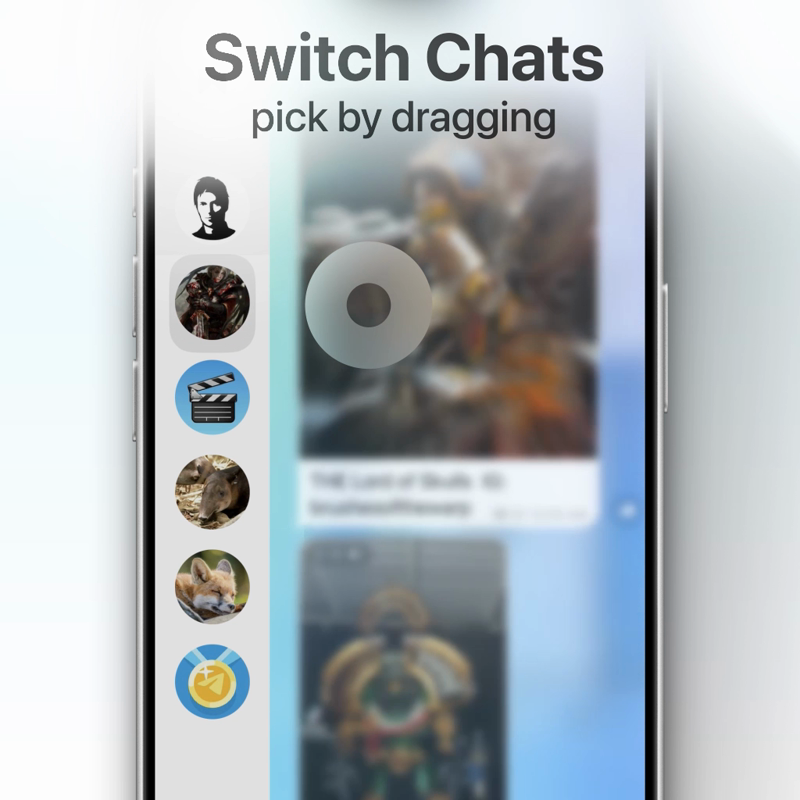

# Tg-ChatSideBar

A standalone UIKit prototype: a chat sidebar with **three places to let go**.
Swipe back from a chat and release anywhere mid-gesture — the chat list can stay
as a narrow column beside the chat instead of the swipe being forced to resolve
into "back" or "not back".

No storyboards, no XIBs, no dependencies. Just `UIKit`, `QuartzCore`, `CoreGraphics`.

[](https://github.com/Ar2c-Twilight/Tg-ChatSideBar/releases/download/demo/main.mp4)

*↑ click for the 13s demo (24 MB, MP4)*

---

## The idea

One scalar drives the whole container: `progress`, where `0` means the chat covers
the screen and `1` means the list does. The exposed column width, the dim, the corner
radius, the cell appearance — all of it is a pure function of that number.

A resting point in between therefore needs no new geometry, only a third answer to
*where does this gesture land?*

```swift
enum SidebarDetent {
    case chat    // chat full screen, list not visible
    case peek    // both on screen: a narrow column of list, chat pushed right
    case list    // list full screen — by definition nothing is selected
}
```

## Choosing the detent

`.peek` has to be picked from a finger that is still moving, so it is judged on
position and momentum at the same time:

| | value | why |
|---|---|---|
| `peekWindow` | `0.2 ... 0.8` | Single window, **no** hysteresis. This is a position — the user can see where it is, so there is nothing to flicker. |
| `momentumEnterThreshold` | `0.4` (≈315 pt/s) | Momentum is the noisy input, so the hysteresis lives here. |
| `momentumExitThreshold` | `0.6` (≈470 pt/s) | Revoking the prediction is deliberately harder than granting it. Velocity samples jump frame to frame, and the prediction drives parallax in real time — one threshold makes the list judder while a finger hovers near the boundary. |

Momentum is projected into the same units as `progress` using the WWDC18 formula:
*how much further would this flick still carry, as a fraction of the screen width.*

The column is `cellLeftInset * 2 + avatarSize` (= 92 pt), not a fraction of the screen.
Deriving it from a size keeps the avatar centred in the column with equal padding on
every device, where a fraction drifts. Width was tried at 76 pt (a square cell) first —
the avatar ended up flush against the column's right edge, 16 left and 0 right.

## Vertical takeover

Once `.peek` is predicted, moving half a row vertically **takes the whole gesture over**:
the horizontal component stops being handled, the detent locks to `.peek`, and the rest
of the drag slides a highlight block up and down the column to pick a chat.

After the takeover the block follows the finger's **absolute position**, not accumulated
displacement — so there is no relationship left between how far it travelled and where
it lands, and the lock reads as instant.

## The jelly

The highlight block's top and bottom edges each get their own spring, and **the leading
edge is stiffer than the trailing one**. The block stretches while it moves and springs
back when it lands. The deformation is the lag between two springs, not an animation of
its own.

## Interruptibility

`SpringScalar` integrates a spring on a `CADisplayLink` rather than using
`UIViewPropertyAnimator` or `CASpringAnimation`. Both of those animate a *property* and
hand back only a fraction, while catching a gesture mid-flight needs the value **and the
velocity** at an arbitrary moment. Here that is just `stop()`, which returns both — the
finger continues with no snap and no rebound.

## Not competing for the touch

`PeekTouchSniffer` watches touches without ever taking them. A sidebar parked at `.peek`
is dismissed by a scroll on the chat — while that same scroll still has to scroll the
chat. It never leaves `.possible`, and a recognizer that never reaches `.began` takes
part in no arbitration: it blocks nothing, and nothing underneath has to be told to fail.

`SGBGestureRecognizer` (SGB = *slide to go back*) claims horizontal drags anywhere on
screen, not just from the edge. Its structure follows Telegram's
`InteractiveTransitionGestureRecognizer`: it decides whether a touch is its own by
setting `state = .failed` in `touchesBegan`/`touchesMoved` instead of asking a delegate,
and withholds `super.touchesMoved` until it is sure — so UIKit sees `.possible` the whole
time it is making up its mind, and content never jumps under the finger.

## Layout

```
TgChatSideBar/
├── Sidebar/
│   ├── ChatSidebarContainerViewController.swift   the container; owns progress
│   ├── SidebarDetent.swift                        detents + every tunable number
│   ├── SpringScalar.swift                         interruptible spring on a display link
│   ├── SGBGestureRecognizer.swift                 the horizontal pan
│   └── PeekTouchSniffer.swift                     non-competing touch observer
├── ChatList/                                      list, cells, leading-edge geometry
├── Chat/                                          chat page, bubbles, header
└── Common/                                        blur, shadow, motion tracking, debug HUD
```

All the tunable numbers live in one place, `SidebarMetrics` — they all need repeated
trials on a device, and none of them is worth hunting for.

## Build

```sh
open TgChatSideBar.xcodeproj     # Xcode 16+, iOS 17+
```

Or from the command line:

```sh
xcodebuild -project TgChatSideBar.xcodeproj -scheme TgChatSideBar \
           -destination 'platform=iOS Simulator,name=iPhone 16' build
```

> `Common/BlurFilter.swift` uses the private `CAFilter` class, which is the only way to
> get an **animatable** blur radius (`UIVisualEffectView`'s is fixed; `CIFilter` means a
> whole offscreen pass). Fine for a prototype, will not pass App Review.

## The demo video

`Tg-ChatSideBar-DemoVieo/` holds the After Effects project and the automation used to
shoot it. `resources/simtouch.swift` drives the simulator with synthesized mouse events
from a JSON gesture script, so every take is identical:

```sh
swift simtouch.swift calibrate        # once per window position/scale
swift simtouch.swift record out.json  # perform a gesture, save it
swift simtouch.swift play shot.json   # replay it
```

Coordinates are in device points; calibration converts to screen pixels, so the script
does not depend on where the simulator window sits.

`main/main.aep` is published as a reference for how the shot was assembled, **not as a
project that opens cleanly**. Its footage is deliberately not in the repo: the raw screen
recording is 32 MB of input material, and the reaction animations are Telegram's own
assets, fetched from the official API for the edit — not ours to redistribute. Expect
missing-footage placeholders.

> ⚠️ `simctl io recordVideo` does **not** capture every frame. On a 20.5 s take: 202 gaps
> longer than one frame interval, ~1.2 s of action never captured, worst gaps 180 ms and
> 200 ms. Its timestamps are when the host encoder got to each frame, not when the
> simulator presented it. Resampling to constant frame rate fixes the timeline but cannot
> recover what was never captured.

## Also

The same interaction ported into Telegram for iOS:
**[Ar2c-Twilight/Telegram-iOS @ chat-sidebar](https://github.com/Ar2c-Twilight/Telegram-iOS/tree/chat-sidebar)**

## License

MIT — see [LICENSE](LICENSE).

This prototype is an independent UIKit implementation and contains no Telegram source.
The Telegram fork linked above is GPLv2, as upstream requires; that obligation stays
with the fork and does not extend here.
